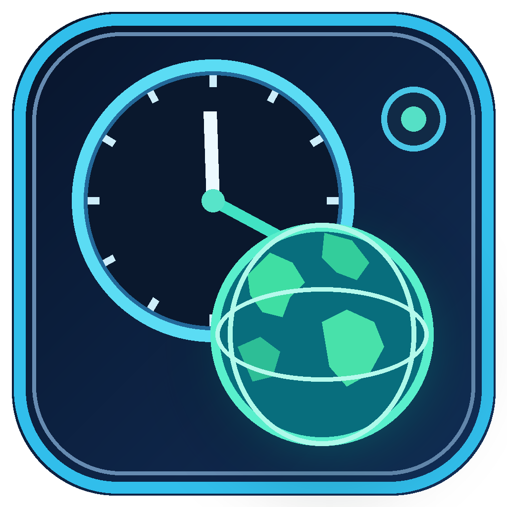
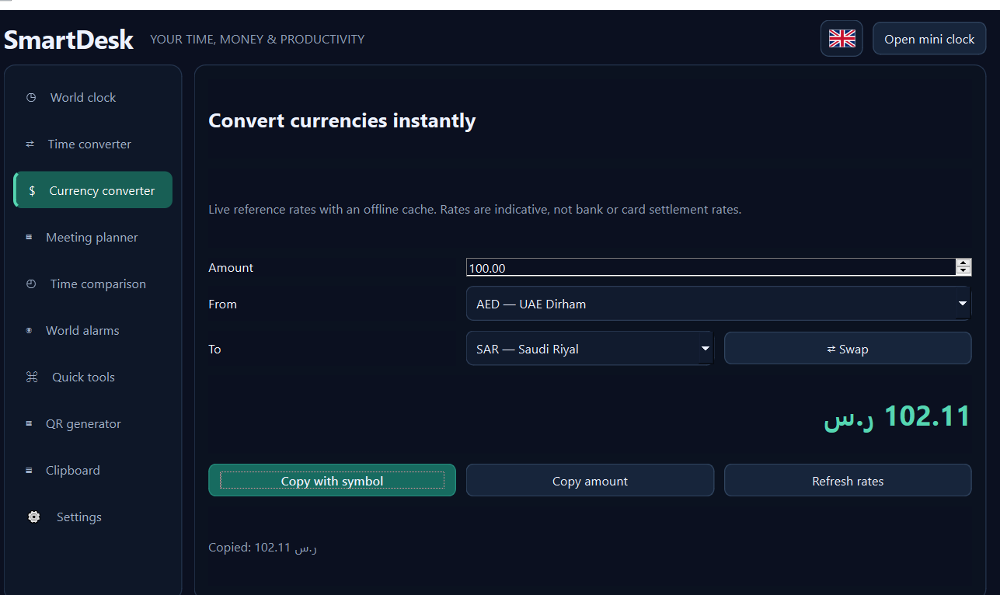
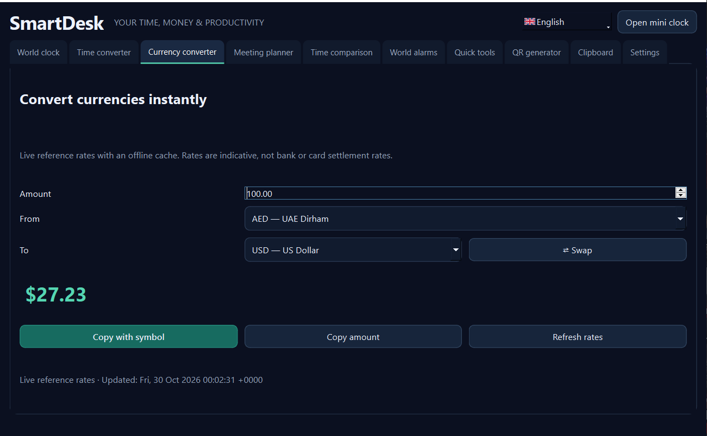
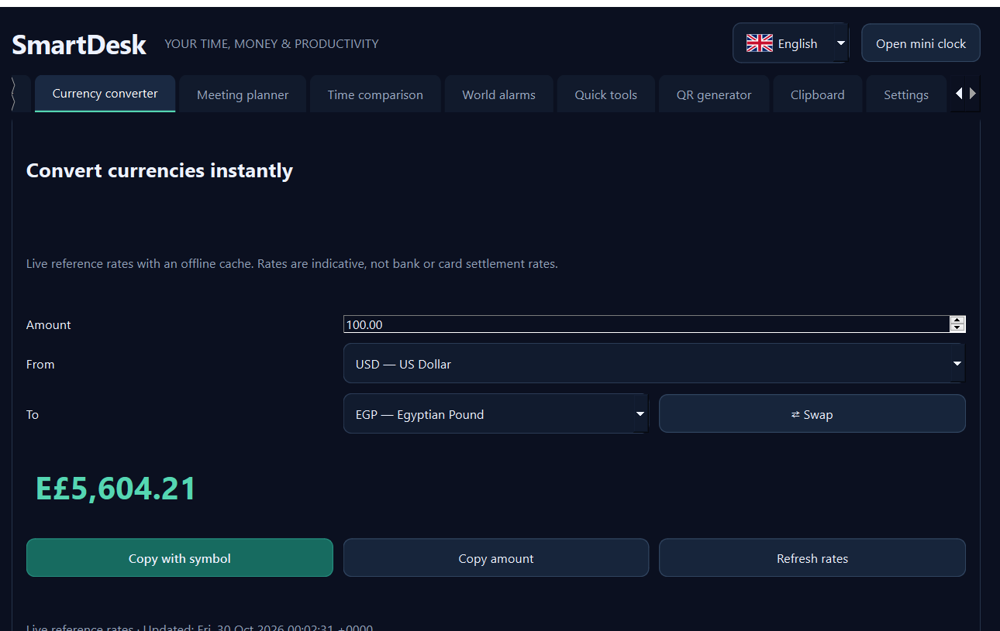

<div align="center">



# SmartDesk

### Your time, money & productivity — in one Windows desktop app.

A lightweight desktop companion for world time, time-zone planning, currency conversion and everyday quick tools.

[](RELEASE.txt)
[](https://www.microsoft.com/windows)
[](LICENSE)

**Created and maintained by [Hussein Badawy](https://github.com/3bHussein)**

</div>

---

## Overview

SmartDesk brings practical time and productivity utilities together in one focused Windows application. It combines a searchable world clock with time-zone planning, currency conversion, floating mini tools and QR generation.

## Features

| Feature | Description |
|---|---|
| 🌍 **World Clock** | Save and organize cities from the IANA time-zone database, search locations and track local time. |
| 🕒 **Time Converter** | Convert a date and time between saved cities and time zones. |
| 💱 **Currency Converter** | Convert currencies using reference exchange rates, with cached rates for offline fallback. Rates are indicative and may differ from bank/card settlement rates. |
| ⚡ **Quick Currency** | Open a compact floating currency converter with `Alt + Shift + C`. |
| 🪟 **Mini Clock** | Keep a small floating clock visible while working; supports always-on-top behavior. |
| 🤝 **Meeting Planner** | Compare participant local times and identify suitable meeting windows. |
| 🌐 **Time Comparison** | Review local dates, times and UTC offsets across saved locations. |
| ⏰ **World Alarms** | Create one-time alarms using a selected city's local time. |
| 🧰 **Quick Tools** | Access the app's built-in everyday utilities. |
| ▦ **QR Generator** | Generate QR codes from text, URLs, contact details or Wi-Fi information, then save them as PNG. |
| 📋 **Clipboard** | Optional clipboard history. Monitoring is off by default; captured history remains in memory for the current app session. |
| 🌍 **Language selector** | Switch the interface language from the available translations. |
| 🚀 **Windows startup** | Enable or disable automatic startup from the app's Settings screen. |

## Screenshots

<p align="center">
  
</p>
<p align="center"><em>Currency converter — compact navigation and a dark interface with teal accents.</em></p>

<p align="center">
  
</p>
<p align="center"><em>Currency conversion with live reference-rate status and quick copy actions.</em></p>

<p align="center">
  
</p>
<p align="center"><em>Example conversion to EGP.</em></p>

## Download / Build

This repository contains the source code. To build the Windows executable:

1. Install **Python 3.11 or newer** and enable **Add Python to PATH**.
2. Download or clone this repository.
3. Run `Install.bat`.
4. The build script installs the dependencies and creates:

   `dist\SmartDesk_1.0.9.5\SmartDesk.exe`

The build uses PyInstaller. The first build requires an internet connection to install Python dependencies.

## Run from source

```bash
python -m pip install -r requirements.txt
python worldclock.pyw
```

## Data & privacy

- SmartDesk stores its local database and settings under `%APPDATA%\WorldClock`.
- The existing `WorldClock` data directory and registry identity are intentionally retained for backward compatibility with earlier versions.
- Clipboard monitoring is **off by default**. When enabled, clipboard history is held in memory and cleared when the application closes.
- Currency rates are reference data, not guaranteed bank, card or transaction rates.

## Version

**Current source release: `1.0.9.5`**

This release includes QR-code scanability improvements: high error correction, a larger preview, native-resolution rendering and a preserved quiet zone.

See [RELEASE.txt](RELEASE.txt) for the release notes.

## Tech stack

- Python
- PySide6 / Qt
- SQLite
- IANA time-zone database (`zoneinfo` / `tzdata`)
- PyInstaller

## Contributing

Issues and pull requests are welcome. Please include clear reproduction steps, your Windows version and relevant error logs when reporting a bug.

## License & copyright

Released under the [MIT License](LICENSE).

**Copyright © 2026 [Hussein Badawy](https://github.com/3bHussein). All rights reserved except as permitted by the MIT License.**
